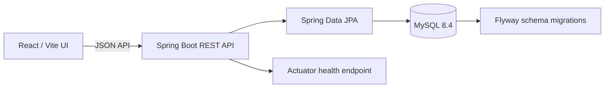
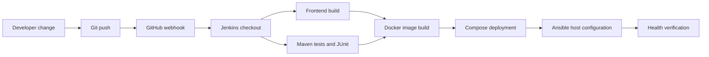

# LoopCycle — E-waste collection and traceability

An educational starter for recording electronic waste submissions and viewing their traceability history. Repository intended by the project brief: [Sonikaelangovan/-E-WASTE-SYSTEM](https://github.com/Sonikaelangovan/-E-WASTE-SYSTEM).

> **Status:** This workspace started empty and the named GitHub repository could not be read because GitHub DNS/network access failed. The files here are a fresh local starter, not a recovered or verified copy of remote work. This is not production-ready: identity, role-based authorization, operational status workflows, notifications, and complete recycling/disposal records remain unimplemented. Do not publish personal pickup addresses from this starter.

## What works in this implementation

- Responsive React dashboard and item inventory with live API calls, empty/error states, and a submission form.
- Spring Boot REST endpoints for creating, listing, and viewing items; Bean Validation rejects invalid submission fields.
- MySQL persistence and Flyway schema migration. Submission creates an initial trace event, and API responses expose a chronological history without serializing entity cycles.
- Reports page calculates basic item/weight summaries from loaded API data and exports the current records to CSV.
- Docker Compose, Jenkins declarative pipeline, and example Ansible web proxy and Compose deployment playbooks.

These features still need review and execution in an environment with a working JDK/Maven, Docker daemon, and network access to dependencies.

## Structure

```text
frontend/                 React + Vite application
backend/                  Spring Boot API, JPA, Flyway migration
ansible/                  Example Nginx and Docker Compose playbooks
compose.yaml              MySQL + API + frontend services
Jenkinsfile               Build and test pipeline
docs/                     Architecture, API, experiment notes
```

## Architecture



## Requirements and local development

Use Node.js 22, Java 21, Maven 3.9+, and MySQL 8.4. Copy `.env.example` to `.env` and replace every placeholder with local-only values. Never commit `.env`.

Frontend:

```powershell
cd frontend
npm install
npm run dev
```

Set `VITE_API_BASE_URL` to `http://localhost:8080/api` (Vite reads this at build/dev startup). Backend:

```powershell
cd backend
$env:DB_URL = 'jdbc:mysql://localhost:3306/ewaste'
$env:DB_USERNAME = 'ewaste_app'
$env:DB_PASSWORD = 'your-local-password'
mvn spring-boot:run
```

Create the database and least-privilege MySQL account before starting the API. Flyway applies the schema. Health endpoint: `http://localhost:8080/actuator/health`.

## Docker Compose

From the repository root, create `.env` with strong unique local values, then:

```powershell
docker compose up --build
```

Open `http://localhost:3000`; API is at `http://localhost:8080/api`. MySQL data persists in the `mysql-data` volume. Stop with `docker compose down`; add `-v` only when you intentionally want to delete the local database volume.

If host port 8080 is already occupied, set both variables before building and starting so the compiled frontend points at the remapped API:

```powershell
$env:BACKEND_PORT = '8081'
$env:VITE_API_BASE_URL = 'http://localhost:8081/api'
docker compose up --build
```

## API

See [docs/api.md](docs/api.md). The current endpoints are `GET /api/items`, `POST /api/items`, and `GET /api/items/{id}`. There is no authentication or authorization yet. Never expose these endpoints beyond a trusted local demo: responses currently include pickup addresses.

## Testing and build

```powershell
cd frontend; npm run build
cd ..\backend; mvn test
```

Frontend lint is configured. Two backend MVC tests cover valid submission/initial trace creation and invalid weight validation. Verified here: `npm run lint` passed; `npm run build` passed; `npm audit` reported 0 vulnerabilities; the Docker backend package/test build passed (2 tests, 0 failures); Compose configuration parsed successfully; and live Compose health/API/database/frontend smoke checks passed. The host Maven command returned “Access is denied”, so backend tests ran through the Docker build.

## Jenkins and GitHub webhook

Create a Jenkins Pipeline job on a Linux agent pointing at the repository and select “Pipeline script from SCM” with the root `Jenkinsfile`. Configure a GitHub webhook to `https://YOUR-JENKINS/github-webhook/`, enable push events, and configure Jenkins credentials/webhook secret according to your installation. The pipeline builds the frontend, runs Maven tests, publishes JUnit reports, and builds Compose images on `main`. It has not been executed or connected to a Jenkins/GitHub service. A Freestyle job on a Linux agent can use `npm ci && npm run build` in `frontend`, `mvn test` in `backend`, and publish `backend/target/surefire-reports/*.xml`.

## Ansible

Copy `ansible/inventory.example.ini` to a private inventory, set the authorized host/user, and ensure SSH and privilege escalation are configured. Validate and run:

```powershell
ansible-playbook -i ansible/inventory.ini ansible/playbooks/webserver.yml --syntax-check
ansible-playbook -i ansible/inventory.ini ansible/playbooks/webserver.yml
ansible-playbook -i ansible/inventory.ini ansible/playbooks/docker.yml --syntax-check
ansible-playbook -i ansible/inventory.ini ansible/playbooks/docker.yml
```

The Docker playbook expects a prepared `.env` and source files available to its copy task. Review its source path and target OS package names before use; no remote host is configured or tested here.

## DevOps classroom experiments

| # | Experiment | Status / demonstration |
|---|---|---|
| 1 | Git clone, status, add, commit, push | Blocked: GitHub DNS failed; no clone or push verified. |
| 2 | Fetch vs pull | Document the distinction: fetch updates remote-tracking refs; pull fetches and integrates. Not demonstrated. |
| 3 | Branch and merge | Use a disposable feature branch and controlled conflict. Not run. |
| 4 | Jenkins Freestyle | Instructions above; Jenkins unavailable/unverified. |
| 5 | Jenkins declarative pipeline | `Jenkinsfile` added; pipeline not run. |
| 6 | GitHub webhook | Setup guidance added; no webhook configured. |
| 7 | Docker lifecycle | Not run; Docker daemon availability unverified. |
| 8 | Dockerfiles and custom images | Frontend/backend Dockerfiles added; images not built. |
| 9 | Compose deployment | Verified locally: MySQL healthy, API health `UP`, item POST/list/detail returned persisted data and trace history, frontend returned HTTP 200. |
| 10 | Automated tests and reports | Two backend MVC tests passed in the Docker Maven build (2 run, 0 failures); frontend lint/build passed. Jenkins report publishing not exercised. |
| 11 | Ansible Nginx setup | Playbook added; syntax and target not verified. |
| 12 | Ansible Docker management | Playbook added; syntax and target not verified. |
| 13 | Integrated CI/CD | Configuration starter only; end-to-end workflow not connected or verified. |

## CI/CD flow



The diagram describes the intended classroom flow; webhook, image push, deployment, Ansible, and health stages are not currently automated end to end by the Jenkinsfile.

## Security and limitations

- Authentication, password hashing, user registration/login, roles, and server-side role enforcement are **not implemented**.
- Pickup data is personal information; current unauthenticated item responses expose the address. Keep the service local and use disposable demo records.
- No collector assignment, pickup scheduling, verification/recycler assignment, recovered-material entries, safe-disposal records, notification service, QR code, upload handling, or full report filters are implemented.
- No default admin account or password is seeded.
- Configure TLS, secrets, backups, least-privilege database credentials, restricted CORS, and access controls before any deployment beyond localhost.

## Troubleshooting and next work

- API unavailable in the UI: start Spring Boot and confirm `/actuator/health`; verify `VITE_API_BASE_URL` and CORS origin.
- Database startup failure: check MySQL reachability, database/user grants, and environment variables.
- Docker Compose refuses startup: ensure every required secret in `.env` is set and Docker Desktop daemon is running.
- Before a classroom demo: restore/verify the GitHub project; implement auth and all role-secured lifecycle transitions; add integration tests; validate migrations and Compose; configure Jenkins credentials/webhook; configure a disposable Ansible host; execute experiments and capture real evidence.

## Screenshots checklist

- [ ] Dashboard with API-connected real metrics
- [ ] Submission form and persisted item details
- [ ] Traceability event timeline
- [ ] Jenkins build and JUnit report
- [ ] Docker Compose services and health
- [ ] Ansible run against a disposable host
