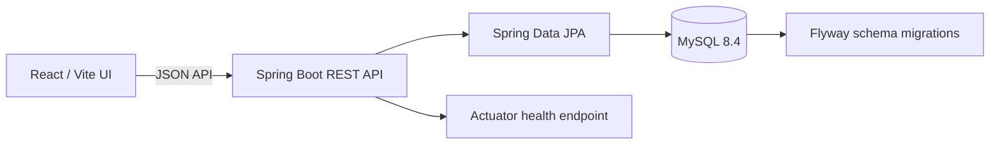
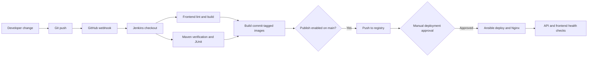

# LoopCycle — E-waste collection and traceability

An educational starter for recording electronic waste submissions and viewing their traceability history. Repository intended by the project brief: [Sonikaelangovan/-E-WASTE-SYSTEM](https://github.com/Sonikaelangovan/-E-WASTE-SYSTEM).

> **Status:** This workspace started empty and the named GitHub repository could not be read because GitHub DNS/network access failed. The files here are a fresh local starter, not a recovered or verified copy of remote work. Authentication, initial role enforcement, core lifecycle transitions, in-app notifications, and filtered privacy-safe reporting are implemented. Email/SMS delivery and detailed recovery/disposal records remain unimplemented. This is not production-ready. Keep personal pickup addresses private.

## What works in this implementation

- Responsive React dashboard and item inventory with live API calls, empty/error states, and a submission form.
- Spring Boot REST endpoints for creating, listing, and viewing items; Bean Validation rejects invalid submission fields.
- MySQL persistence and Flyway schema migration. Submission creates an initial trace event, and API responses expose a chronological history without serializing entity cycles.
- Email/password registration and sign-in, BCrypt password hashes, signed 8-hour bearer tokens, and role checks for `CITIZEN`, `COLLECTOR`, `RECYCLER`, and `ADMIN`.
- Public registration can only create `CITIZEN` accounts. An optional environment-configured initial admin can manage user roles; citizen item queries are restricted to submissions owned by that account.
- Collection lifecycle actions are state-checked and role/assignee-checked: schedule pickup, confirm collection, submit for verification, assign recycler, verify or reject, start recycling, complete recycling, or record safe disposal. Each transition is serialized against concurrent updates and written to the item trace history.
- Filtered report summaries (date and status), category/weight totals, and an authorized CSV export that excludes addresses, descriptions, and account emails.
- Persistent in-app notifications for new submissions and lifecycle updates, with per-user inbox, unread count, and read/mark-all-read actions.
- Docker Compose, Jenkins declarative pipeline, and example Ansible web proxy and Compose deployment playbooks.

These features still need review and execution in an environment with a working JDK/Maven, Docker daemon, and network access to dependencies. Lifecycle transitions have not been integration-tested in this environment.

## Structure

```text
frontend/                 React + Vite application
backend/                  Spring Boot API, JPA, Flyway migration
ansible/                  Example Nginx and Docker Compose playbooks
compose.yaml              MySQL + API + frontend services
Jenkinsfile               Build and test pipeline
docs/                     Architecture, API, experiment notes
docs/deployment.md        Jenkins, registry, and Ansible setup
```

## Architecture



## Requirements and local development

Use Node.js 22, Java 21, Maven 3.9+, and MySQL 8.4. Copy `.env.example` to `.env` and replace every placeholder with local-only values. Never commit `.env`.

Frontend:

```powershell
cd frontend
npm install
npm run dev
```

Set `VITE_API_BASE_URL` to `http://localhost:8080/api` (Vite reads this at build/dev startup). Configure a random JWT signing secret of at least 32 characters in `APP_JWT_SECRET`. To provision the first admin, also set `ADMIN_EMAIL` and a unique `ADMIN_PASSWORD` of at least 12 characters and no more than 72 UTF-8 bytes; leave both blank if no admin should be created. For example, generate a signing secret in PowerShell with `[Convert]::ToBase64String([Security.Cryptography.RandomNumberGenerator]::GetBytes(48))`. Never commit `.env` or reuse the example values. Backend:

```powershell
cd backend
$env:DB_URL = 'jdbc:mysql://localhost:3306/ewaste'
$env:DB_USERNAME = 'ewaste_app'
$env:DB_PASSWORD = 'your-local-password'
$env:APP_JWT_SECRET = 'your-random-secret-of-at-least-32-characters'
mvn spring-boot:run
```

Create the database and least-privilege MySQL account before starting the API. Flyway applies the schema. Health endpoint: `http://localhost:8080/actuator/health`.

## Docker Compose

From the repository root, create `.env` with strong unique local values, then:

```powershell
docker compose up --build
```

Open `http://localhost:3000`; API is at `http://localhost:8080/api`. MySQL data persists in the `mysql-data` volume. Stop with `docker compose down`; add `-v` only when you intentionally want to delete the local database volume.

If host port 8080 is already occupied, set both variables before building and starting so the compiled frontend points at the remapped API:

```powershell
$env:BACKEND_PORT = '8081'
$env:VITE_API_BASE_URL = 'http://localhost:8081/api'
docker compose up --build
```

## API

See [docs/api.md](docs/api.md). Register or sign in through `/api/auth/register` or `/api/auth/login`, then send `Authorization: Bearer <token>` with API requests. Citizen users can create items and only list or view their own items. Collectors and admins can access all items; recyclers can read all items. Only admins can manage user roles. Existing item rows created before migration V2 have no owner and remain visible to staff, but not to citizen accounts.

## Testing and build

```powershell
cd frontend; npm run build
cd ..\backend; mvn test
```

Frontend lint is configured. The starter's original MVC tests and Compose smoke checks passed before authentication, lifecycle, notification, and reporting changes. Current frontend lint passes; these newer backend migrations and API flows still need build and integration verification. In this Windows environment, Maven returned “Access is denied” and the latest Vite build could not resolve `main.jsx` due to `EPERM`.

## Jenkins and GitHub webhook

The root Jenkinsfile now runs frontend lint/build, Maven verification, and Docker image builds across branches. Publication and deployment are explicit `main`-branch parameters; deployment waits for a human approval, pins image tags to the commit SHA, uses Ansible to deploy Compose and configure Nginx, and checks service health. Configure the Linux agent, credentials, registry, webhook, and target host using [docs/deployment.md](docs/deployment.md). This pipeline and its deployment have not been connected to or run against Jenkins infrastructure.

## Ansible

Copy `ansible/inventory.example.ini` to a private inventory, set the authorized host/user, and ensure SSH and privilege escalation are configured. The playbooks now install Docker/Nginx, pull commit-pinned images, deploy without copying source code, check health, and configure the reverse proxy. See [docs/deployment.md](docs/deployment.md) for required `.env` values and commands. Validate and run:

```powershell
ansible-playbook -i ansible/inventory.ini ansible/playbooks/webserver.yml --syntax-check
ansible-playbook -i ansible/inventory.ini ansible/playbooks/webserver.yml
ansible-playbook -i ansible/inventory.ini ansible/playbooks/docker.yml --syntax-check
ansible-playbook -i ansible/inventory.ini ansible/playbooks/docker.yml
```

The Docker playbook expects a prepared `.env` and registry images already pushed. Review its source path and Debian/Ubuntu package names before use; no remote host is configured or tested here.

## DevOps classroom experiments

| # | Experiment | Status / demonstration |
|---|---|---|
| 1 | Git clone, status, add, commit, push | Remote was empty, so initialized this workspace, created `feature/ewaste-traceability`, committed, and pushed successfully. |
| 2 | Fetch vs pull | Document the distinction: fetch updates remote-tracking refs; pull fetches and integrates. Not demonstrated. |
| 3 | Branch and merge | Use a disposable feature branch and controlled conflict. Not run. |
| 4 | Jenkins Freestyle | Instructions above; Jenkins unavailable/unverified. |
| 5 | Jenkins declarative pipeline | `Jenkinsfile` runs checks and image build; publication/deploy are parameter-gated; pipeline not run. |
| 6 | GitHub webhook | Setup guidance added; no webhook configured. |
| 7 | Docker lifecycle | Not run; Docker daemon availability unverified. |
| 8 | Dockerfiles and custom images | Frontend/backend Dockerfiles added; images not built. |
| 9 | Compose deployment | Verified locally: MySQL healthy, API health `UP`, item POST/list/detail returned persisted data and trace history, frontend returned HTTP 200. |
| 10 | Automated tests and reports | Two backend MVC tests passed in the Docker Maven build (2 run, 0 failures); frontend lint/build passed. Jenkins report publishing not exercised. |
| 11 | Ansible Nginx setup | Playbook added; syntax and target not verified. |
| 12 | Ansible Docker management | Playbook added; syntax and target not verified. |
| 13 | Integrated CI/CD | Jenkins-to-registry-to-Ansible deployment flow configured; external services/credentials absent and workflow not run end to end. |

## CI/CD flow



The Jenkinsfile now contains the build, optional image-publish, and approval-gated Ansible deployment stages. The webhook and external Jenkins, registry, credentials, and target host still need configuration, and the flow has not been run end to end.

## Security and limitations

- Lifecycle actions are available through the API and on an item's trace page. Admin can set account roles through the admin API; no role-management screen is included yet. Evidence uploads, facilities, recovered-material weights, and disposal certificates are still not modeled.
- The browser stores bearer tokens in local storage, so use HTTPS on any shared network and avoid untrusted scripts/browser extensions. Tokens expire after eight hours; role changes invalidate existing tokens and require another sign-in.
- Pickup data is personal information. Keep the service local and use disposable demo records until privacy controls, backups, and operational procedures have been reviewed.
- In-app notifications are implemented; email/SMS delivery is not. Recovery-material weights, facility details, disposal certificates, QR codes, and evidence uploads are not yet modeled.
- No default admin account or password is seeded.
- Configure TLS, secrets, backups, least-privilege database credentials, restricted CORS, and access controls before any deployment beyond localhost.

## Troubleshooting and next work

- API unavailable in the UI: start Spring Boot and confirm `/actuator/health`; verify `VITE_API_BASE_URL` and CORS origin.
- Database startup failure: check MySQL reachability, database/user grants, and environment variables.
- Docker Compose refuses startup: ensure every required secret in `.env` is set and Docker Desktop daemon is running.
- Before a classroom demo: restore/verify the GitHub project; add integration tests for role boundaries and every transition; validate migrations and Compose; configure Jenkins credentials/webhook; configure a disposable Ansible host; execute experiments and capture real evidence.

## Screenshots checklist

- [ ] Dashboard with API-connected real metrics
- [ ] Submission form and persisted item details
- [ ] Traceability event timeline
- [ ] Jenkins build and JUnit report
- [ ] Docker Compose services and health
- [ ] Ansible run against a disposable host
